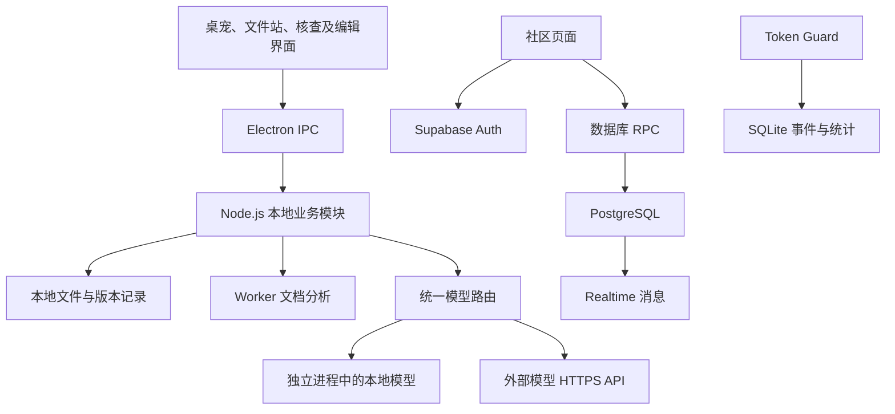

# 技术架构

## 展示网站与桌面软件

本仓库只有静态网站。浏览器加载 HTML、CSS 和 JavaScript 后在本机展示产品介绍和模拟交互，不调用真实核查服务。桌面端源码在单独的开发目录中，不能通过克隆本仓库取得。

## 桌面应用的结构

上图概括产品模块；不是本仓库目录中的服务部署图。不同窗口的隔离配置存在差异，不能据此声称所有窗口都启用了相同安全策略。

## 前端和本地后端

主体使用 HTML、CSS 和原生 JavaScript。Electron 提供桌面窗口、系统交互和 Node.js 主进程；渲染界面通过 IPC 调用业务。部分窗口通过 preload/contextBridge 暴露受限能力。

文档分析使用 worker_threads，本地模型使用 utilityProcess，避免将耗时计算全部放在界面进程。

## 社区数据库与接口

社区使用 Supabase 托管的 PostgreSQL。SQL/PL/pgSQL 函数承担部分业务逻辑，通过 community_v1_* RPC 暴露操作。

身份来自 Supabase Auth；RLS、函数内归属校验和明确授权共同限制访问。写入使用账号绑定的请求标识处理重试，编辑检查版本，审计记录保存变化。部分函数使用 SECURITY DEFINER 并固定 search_path。

Realtime 用于消息相关订阅。Deno Edge Functions 承载托管核查、账号生命周期等辅助业务。静态网站本身没有部署这些服务。

## 证据与核查

原始文件保留副本和 SHA-256 摘要；解析内容按文档、正文块及段落组织。证据保存版本、原句、偏移及可用的页码、工作表等信息。

检查结合文本匹配、数字特征、表格上下文和确定性计算。部分十进制运算采用 BigInt 加缩放整数。复杂表格和公式存在支持边界，不能等同于完整表格计算引擎。

专家修订绑定原文快照和版本，应用前复查目标，防止覆盖其他修改。候选规则保存字段角色、适用条件和证据；当前单数值规则由专家补充结构化信息后提炼，支持新案例试跑。

## 模型接口

统一 callLLM 入口按业务角色选择本地或远程模型。API 层适配 OpenAI 兼容、Anthropic Messages 和 Gemini 格式，封装超时、重试和用量返回。

本地 GGUF 模型由 node-llama-cpp 加载。OCR 使用 RapidOCR/ONNX 辅助运行时及 Windows OCR 回退。发行版部分凭据通过 Electron safeStorage 保存。

## Token Guard 与存储

Token Guard 前端使用 React、TypeScript 和 uPlot；后端增量读取会话日志并进行去重和累计差分。SQLite 开启 WAL，事件与读取游标在同一事务提交，保存速率桶、异常和工作流状态；EWMA 用于动态基线。

文件站、核查报告和修订主要使用文件系统、JSON/JSONL。社区 PostgreSQL、本地 SQLite 与 JSON 存储承担不同职责。独立授权服务使用 Node.js HTTP 和自己的文件持久化。

## 不能从架构推断的结论

依赖存在不等于所有功能已上线；部署脚本不等于生产高可用；模拟用例不等于真实业务准确率。独立金融评价器实验的训练结果，不应写成本软件的线上效果。
